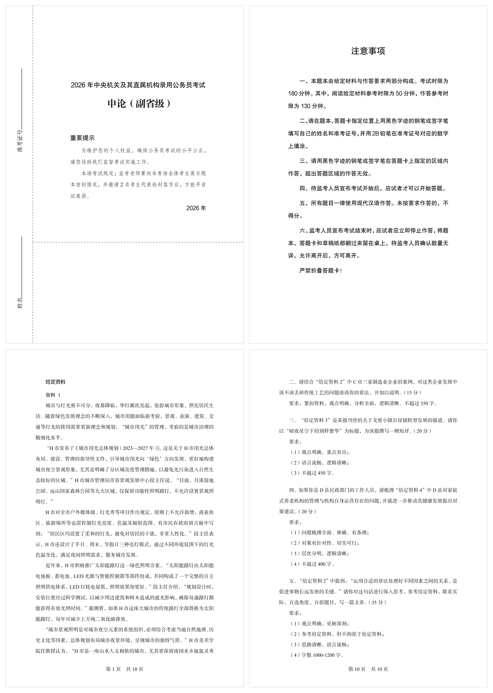

# 国考申论历年试卷（2000–2026）

中央机关及其直属机构录用公务员考试《申论》真题，Typst 源码 + 编译 PDF。



## 内容

- `题目册/` — 49 份试卷的 Typst 源码（2000–2026，含副省级 / 地市级 / 行政执法卷）
- `申论答题模拟/` — 方格纸答题模拟器
- `PDF题目册/` — 编译产出的 PDF
- `.github/scripts/` — 编译、试卷生成、答案记录脚本
- `.github/prompts/` — 个人答题记录 Prompt

## 编译

```powershell
python ".github/scripts/编译试卷.py"
```

## 答题模拟

格纸原位光标编辑器，按国考答题卡规则实时排版：编号合并、双标点合并、双数字同格、破折号占两格、标点避头；可调字体 / 每行格数 / 字数要求，支持缩放、沉浸模式、本地自动存稿与文本导入导出。

```powershell
cd "申论答题模拟"
bun install
bun run dev
```

在线版：<https://leonardotan19.github.io/GuoKaoShenLun/>

## License

[MIT](LICENSE)

## 免责声明

本仓库仅供个人学习交流，禁止商业用途。试卷原文及给定材料版权归原命题机构与原作者所有，如有侵权请联系删除。
